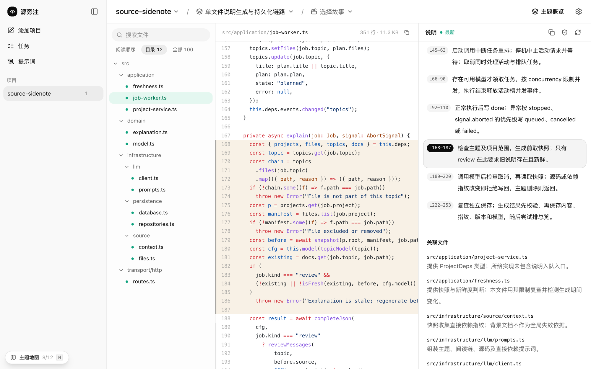
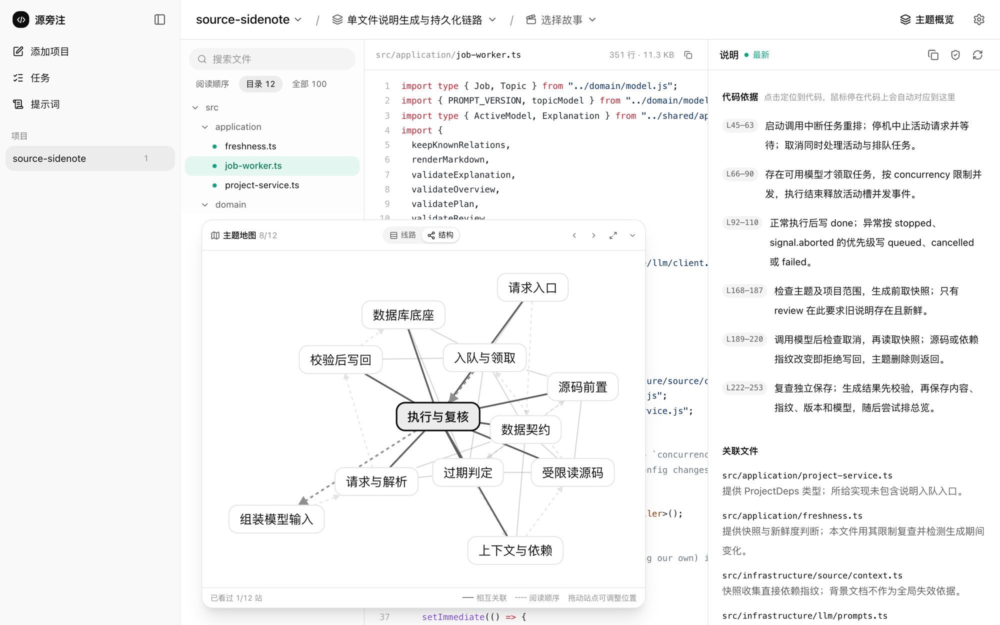
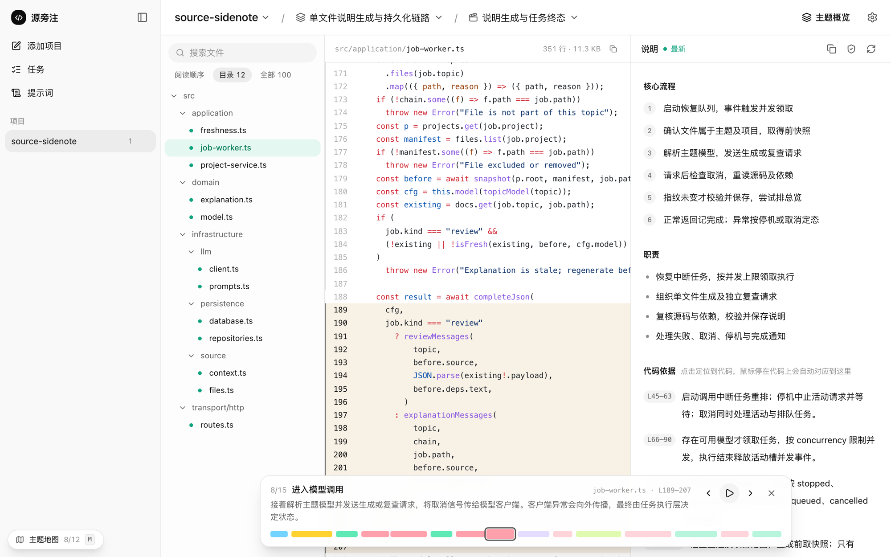
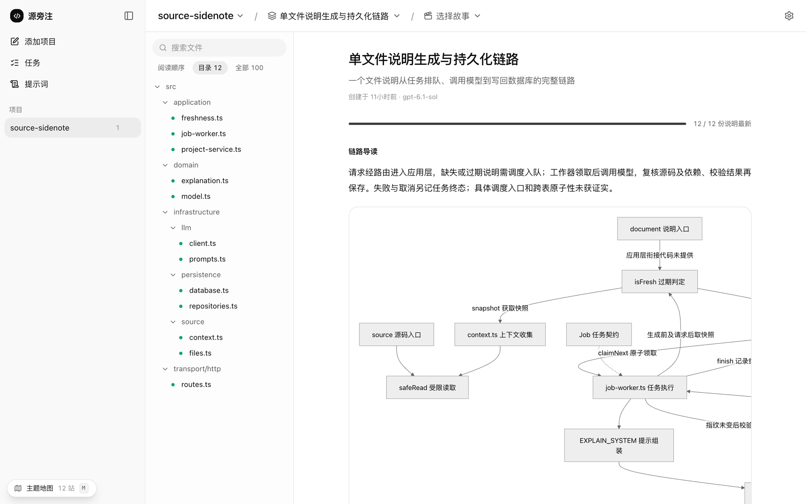
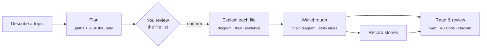

<p align="center">
  
</p>

<h1 align="center">Source Sidenote</h1>

<p align="center">
  <strong>Understand an unfamiliar codebase one flow at a time —<br>with diagrams and explanations pinned to the exact lines they describe.</strong>
</p>

<p align="center">
  <a href="https://github.com/zhuliminl/source-sidenote/actions/workflows/ci.yml"></a>
  <a href="LICENSE"></a>
  
  
</p>

<p align="center">
  <a href="README.zh-CN.md">简体中文</a> ·
  <a href="#quick-start">Quick start</a> ·
  <a href="#how-it-works">How it works</a> ·
  <a href="docs/architecture.md">Architecture</a>
</p>

<picture>
  <source media="(prefers-color-scheme: dark)" srcset="docs/images/reader-dark.png">
  
</picture>

<p align="center"><sub>Hover any block of code and its explanation lines up beside it. Click an explanation and the code scrolls to meet it.</sub></p>

---

## Why

Reading code you didn't write is mostly navigation: which files matter, in what order, and what each block is for. Asking an AI to "summarise the repo" is expensive and vague. Asking about a single file loses the bigger picture.

Source Sidenote works **per topic**. You describe the flow you want to understand — _"how does a queued job become a saved explanation?"_ — and a model proposes the files that matter and a reading order. **You approve the list, and only then is any source code sent to the model.** Every explanation leads with a diagram that uses the real names from the code, and every claim points to a line range, so you can check it against the code instead of taking it on trust.

## Features

### 🧭 Topics you approve

Describe what you want to learn. The planner sees only file paths and the README, then proposes files with a reason for each. Reorder, remove or add files, add your own instructions, pick the model, and confirm. Each topic gets a walkthrough that strings its files together — and suggests questions worth exploring.

### 🔗 Code and explanation in lockstep

Explanations are **diagram-first**: Mermaid flowcharts whose nodes are named after real functions and classes, and clicking a node jumps to its lines. Below the diagram, every piece of _evidence_ is bound to a block of code. Hover a block and its evidence highlights and scrolls level with it; hover an evidence entry and the code lights up. One colour, one meaning, on both sides.

### 🗺️ A map of the whole flow



A floating map you can drag, resize and park anywhere (toggle with <kbd>M</kbd>, enlarge with <kbd>Shift</kbd>+<kbd>M</kbd>). **Line** mode lists the stations in reading order; **structure** mode spreads the files out as a graph of how they relate. Drag stations to build your own mental map — positions are remembered per topic.

### 🎬 Stories: a recorded walk through the code



Ask a concrete question and the model _records_ a step-by-step tour: open this file, look at these lines, here is what happens and how it connects to the previous step. Scrub the timeline, step with <kbd>←</kbd> <kbd>→</kbd>, or press play — the reader follows along.

### 🧑‍💻 Review from your editor

The **VS Code** extension and the **Neovim** plugin put the same explanations next to your code: evidence blocks marked in the gutter, the block under the cursor highlighted and explained on hover, a side panel with the diagram, AI review and regenerate, and the topic's reading order. Authoring — topics, stories, settings — stays in the web reader.

### 🔒 Your model, your machine

- Runs as a local service bound to `127.0.0.1`; projects, explanations and settings live in one SQLite file on your disk.
- Works with any **OpenAI-compatible** or **Anthropic-compatible** endpoint — hosted providers, internal gateways or a local proxy. Configure several and choose per topic.
- **Every prompt is shown verbatim** in the app, along with exactly what is sent with it.
- Explanations record the source hash, direct dependencies, prompt version and model, and are marked _stale_ when any of them change.

<details>
<summary><strong>The topic walkthrough</strong></summary>
<br>

</details>

## How it works



A single Node service owns the model calls, the job queue and the SQLite store. The web reader and the editor plugins are thin clients of its HTTP API, so an explanation generated once is shared everywhere and survives restarts.

## Quick start

**Requirements:** Node.js **26.12+** (the built-in `node:sqlite` is still a release candidate, so the major version is pinned) and access to a chat model.

```sh
git clone https://github.com/zhuliminl/source-sidenote.git
cd source-sidenote
npm ci
npm test     # builds the service and the web reader, then runs the tests
npm start    # serves http://127.0.0.1:47831 and opens it
```

Then, in the web reader:

1. **Settings → Models** — add a provider (OpenAI, Anthropic, DeepSeek, a local proxy…), fetch or add models, test the connection, and pick a default.
2. **Add a project** — pick a folder, or run `node dist/cli/main.js add` inside it. Adding only scans files; nothing is sent to a model.
3. **New topic** — describe a flow, review the proposed files, confirm.

Run `npm link` once to get a global `sidenote` command:

```text
sidenote start [--no-open] [--port 47831]
sidenote add [directory]
sidenote status | projects | ui | stop
```

## Editor plugins

|                                  | VS Code                   | Neovim              |
| -------------------------------- | ------------------------- | ------------------- |
| Evidence marked beside the code  | gutter bar                | sign column         |
| Block under the cursor           | highlighted + panel entry | highlighted + float |
| Explanation panel                | webview with diagram      | split window        |
| AI review / regenerate           | ✓                         | ✓                   |
| Reading order                    | Explorer view             | quickfix list       |
| Jump to the same spot on the web | ✓                         | ✓                   |

**VS Code** — build and install the extension from [`editors/vscode`](editors/vscode/README.md):

```sh
npm run build -w editors/vscode
cd editors/vscode
npx @vscode/vsce package --no-dependencies --allow-missing-repository --skip-license
code --install-extension source-sidenote-vscode-0.1.0.vsix
```

**Neovim 0.10+** (needs `curl`):

```lua
vim.opt.runtimepath:append('/path/to/source-sidenote/editors/neovim')
require('sidenote').setup()
-- :Sidenote  :SidenoteTopic  :SidenoteReview  :SidenoteOrder  :SidenoteWeb
```

No global key mappings are added. Inside the explanation window, `<CR>` jumps to the code, and `gr` / `gR` / `gt` / `go` / `gw` regenerate, review, switch topic, show the reading order and open the web reader.

## Let a coding agent write the explanations (MCP)

Source Sidenote's own model calls see one file at a time. A coding agent such as **Claude Code** or **Codex** can explore the whole repository — follow callers and callees, read tests — before it writes. `sidenote mcp` is a [Model Context Protocol](https://modelcontextprotocol.io) server that lets an agent read your topics and submit explanations, walkthroughs and stories. Everything it submits is validated by the service (shape, real paths, line ranges inside the file) and attributed to the agent, then shows up in the web reader and the editor plugins immediately.

**Claude Code**

```sh
claude mcp add sidenote -- node /path/to/source-sidenote/dist/cli/main.js mcp
```

Then run `/mcp__sidenote__explain_topic` (optionally with a topic id), or just ask: _"Use the sidenote tools to write the explanations for topic …"_.

**Codex** — add to `~/.codex/config.toml`:

```toml
[mcp_servers.sidenote]
command = "node"
args = ["/path/to/source-sidenote/dist/cli/main.js", "mcp"]
```

The service must be running (`sidenote start`). Tools: `get_guide` (the writing guide every agent should follow), `list_projects`, `list_topics`, `get_topic`, `locate_file`, `create_topic` (the agent picks the files), `get_explanation`, `submit_explanation`, `submit_overview`, `submit_story`. Agents are told to read only and never modify files; explanations they write go stale when the code changes, not when you switch models.

## Privacy and cost

- Nothing leaves your machine until you confirm a topic, and then only the files you approved (plus short snippets of their direct imports) go to the model you chose.
- Ignored files, dependencies, build output and likely secrets are excluded from scanning.
- A topic costs roughly _files + 2_ model calls (plan, one per file, walkthrough). Files per topic, concurrency and timeouts are configurable — they bound requests; they are not a spending cap.
- API keys are stored in a `0600` config file and are never sent back to the browser.

## Status

**0.1 — developer preview.** It is already used on real projects, but:

- The interface is currently **Chinese only**; an English UI is on the roadmap.
- Not yet published to npm, the VS Code Marketplace or Open VSX — install from source as above.
- The automated tests use a mock model. Explanation quality depends on your model; treat an AI review pass as a second opinion, not proof.

**Roadmap:** English UI · npm and Marketplace releases · richer structural signals for planning large repositories (import graph, symbols) · incremental re-indexing and budgets.

## Contributing

Issues and pull requests are welcome. Please read [CONTRIBUTING.md](CONTRIBUTING.md) and [SECURITY.md](SECURITY.md) first — in short: `npm ci && npm test`, keep business logic in the service, never commit config, databases or real business code, and reproduce problems with small public or synthetic projects.

Further reading: [architecture](docs/architecture.md) · [landscape](docs/landscape.md) · [acceptance checklist](docs/acceptance.md).

## License

[MIT](LICENSE) © Source Sidenote contributors
