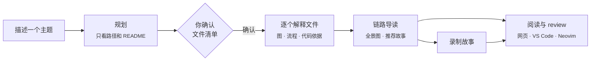

<p align="center">
  
</p>

<h1 align="center">源旁注 · Source Sidenote</h1>

<p align="center">
  <strong>一次读懂一条链路——<br>图和说明都钉在它所描述的那几行代码旁边。</strong>
</p>

<p align="center">
  <a href="https://github.com/zhuliminl/source-sidenote/actions/workflows/ci.yml"></a>
  <a href="LICENSE"></a>
  
  
</p>

<p align="center">
  <a href="README.md">English</a> ·
  <a href="#快速开始">快速开始</a> ·
  <a href="#工作原理">工作原理</a> ·
  <a href="docs/architecture.md">架构</a>
</p>

<picture>
  <source media="(prefers-color-scheme: dark)" srcset="docs/images/reader-dark.png">
  
</picture>

<p align="center"><sub>鼠标停在任意一段代码上，对应的说明就和它并排对齐；点一条说明，代码滚过来和它对齐。</sub></p>

---

## 为什么做它

读别人的代码，大部分时间花在找路上：哪些文件重要、按什么顺序看、每一段在干什么。让 AI “总结整个仓库”又贵又空泛；只问一个文件，又丢了全局。

源旁注按**主题**工作。你描述想弄懂的链路——比如“一个排队的任务是怎么变成一份保存下来的说明的？”——模型先挑出相关文件并给出阅读顺序。**你确认文件清单之后，才会有源码发给模型。** 每份说明都以图开头，图里用的是代码里的真实名字；每一条结论都指向具体的行号范围，你可以对照代码核实，而不是只能相信它。

## 功能

### 🧭 由你确认的主题

描述想了解什么。规划阶段只看文件路径和 README，给出要读的文件以及每个文件的入选理由。你可以调整顺序、删除或补充文件、写补充要求、选择模型，然后确认。每个主题都有一份把文件串起来的链路导读，并推荐几个值得深入的问题。

### 🔗 代码和说明严格对应

说明**以图为主**：Mermaid 流程图的节点用真实的函数名和类名，点击节点跳到对应代码。图下面的每一条“代码依据”都绑定一段代码：鼠标停在代码上，对应依据高亮并滚到与它同一高度；停在依据上，代码整段亮起。两边同一种颜色，同一个含义。

### 🗺️ 整条链路的地图


可以拖动、调整大小、放在任意位置的悬浮地图（<kbd>M</kbd> 显示或隐藏，<kbd>Shift</kbd>+<kbd>M</kbd> 放大）。**线路**模式按阅读顺序列出每一站；**结构**模式把文件铺成关系图。站点可以拖动，按你自己的理解摆出一张代码地图，位置按主题记住。

### 🎬 故事：AI 录好的代码导览


提一个具体问题，模型会“录制”一段一步步的导览：打开这个文件、看这几行、这里发生了什么、和上一步怎么衔接。拖动进度条、用 <kbd>←</kbd> <kbd>→</kbd> 前后切换，或者自动播放，阅读器跟着走。

### 🧑‍💻 在编辑器里 review

**VS Code** 扩展和 **Neovim** 插件把同样的说明放到你的代码旁边：代码依据标在行号旁，光标所在段落高亮并在悬停时说明，侧边面板显示图，可以 AI 复查、重新生成，查看主题的阅读顺序。新建主题、故事和设置都在网页阅读器里完成。

### 🔒 你的模型，你的机器

- 作为本机服务运行，只监听 `127.0.0.1`；项目、说明和设置都保存在你磁盘上的一个 SQLite 文件里。
- 支持任何 **OpenAI 兼容**或 **Anthropic 兼容**的接口：云服务、内网网关或本地代理都可以。可以配置多个，每个主题单独选择。
- **所有提示词都在应用里原样展示**，并写明会随提示词发送哪些内容。
- 说明记录源码哈希、直接依赖、提示词版本和模型，任何一项变化都会标为“已过期”。

<details>
<summary><strong>主题的链路导读</strong></summary>
<br>

</details>

## 工作原理



一个 Node 服务负责模型调用、任务队列和 SQLite 存储。网页阅读器和编辑器插件都只是它 HTTP 接口的客户端，所以一份说明生成一次，到处都能用，重启后也还在。

## 快速开始

**需要：** Node.js **26.12+**（内置的 `node:sqlite` 仍是候选版本，因此锁定主版本），以及一个可用的对话模型。

```sh
git clone https://github.com/zhuliminl/source-sidenote.git
cd source-sidenote
npm ci
npm test     # 构建服务端和网页阅读器，并运行测试
npm start    # 启动 http://127.0.0.1:47831 并在浏览器打开
```

然后在网页阅读器里：

1. **设置 → 模型**：添加供应商（OpenAI、Anthropic、DeepSeek、本地代理……），获取或添加模型，测试连接，设一个默认模型。
2. **添加项目**：选择文件夹，或在项目目录里运行 `node dist/cli/main.js add`。添加只会扫描文件，不会调用模型。
3. **新建主题**：描述一条链路，检查 AI 挑出的文件，确认。

运行一次 `npm link`，就能在任何地方使用 `sidenote` 命令：

```text
sidenote start [--no-open] [--port 47831]
sidenote add [directory]
sidenote status | projects | ui | stop
```

## 编辑器插件

|                    | VS Code         | Neovim        |
| ------------------ | --------------- | ------------- |
| 代码依据标在代码旁 | 行号旁竖线      | sign 列       |
| 光标所在段落       | 高亮 + 面板对应 | 高亮 + 浮窗   |
| 说明面板           | 带图的 Webview  | 右侧分屏      |
| AI 复查 / 重新生成 | ✓               | ✓             |
| 阅读顺序           | 资源管理器视图  | quickfix 列表 |
| 跳到网页同一位置   | ✓               | ✓             |

**VS Code**：在 [`editors/vscode`](editors/vscode/README.md) 构建并安装扩展：

```sh
npm run build -w editors/vscode
cd editors/vscode
npx @vscode/vsce package --no-dependencies --allow-missing-repository --skip-license
code --install-extension source-sidenote-vscode-0.1.0.vsix
```

**Neovim 0.10+**（需要 `curl`）：

```lua
vim.opt.runtimepath:append('/path/to/source-sidenote/editors/neovim')
require('sidenote').setup()
-- :Sidenote  :SidenoteTopic  :SidenoteReview  :SidenoteOrder  :SidenoteWeb
```

插件不添加任何全局快捷键。在说明窗口里，`<CR>` 跳到代码，`gr` / `gR` / `gt` / `go` / `gw` 分别是重新生成、AI 复查、切换主题、阅读顺序和打开网页。

## 隐私与费用

- 在你确认主题之前，没有任何内容离开你的机器；确认后，只有你认可的文件（以及它们直接导入的少量片段）会发给你选择的模型。
- 被忽略的文件、依赖、构建产物和疑似密钥都不会被扫描。
- 一个主题大约调用模型“文件数 + 2”次（规划、每个文件一次、导读）。每个主题的文件上限、并发和超时都可以配置——它们限制的是请求范围，不是费用上限。
- API Key 保存在权限为 `0600` 的配置文件里，不会回传给浏览器。

## 项目状态

**0.1 开发预览版。** 已经在真实项目中使用，但：

- 界面目前**只有中文**，英文界面在路线图上。
- 尚未发布到 npm、VS Code 插件市场或 Open VSX，请按上面的方式从源码安装。
- 自动化测试使用模拟模型。说明质量取决于你用的模型；AI 复查通过只是第二意见，不代表正确。

**路线图：** 英文界面 · 发布到 npm 和插件市场 · 规划大仓库时使用更丰富的结构信息（导入图、符号）· 增量重建索引与预算控制。

## 参与贡献

欢迎提 issue 和 PR。请先阅读 [贡献说明](CONTRIBUTING.md) 和 [安全说明](SECURITY.md)。简单来说：`npm ci && npm test`，业务逻辑放在服务端，不要提交配置、数据库或真实业务代码，用小型公开或合成项目复现问题。

延伸阅读：[架构](docs/architecture.md) · [竞品与定位](docs/landscape.md) · [验收清单](docs/acceptance.md)。

## 许可

[MIT](LICENSE) © Source Sidenote contributors
